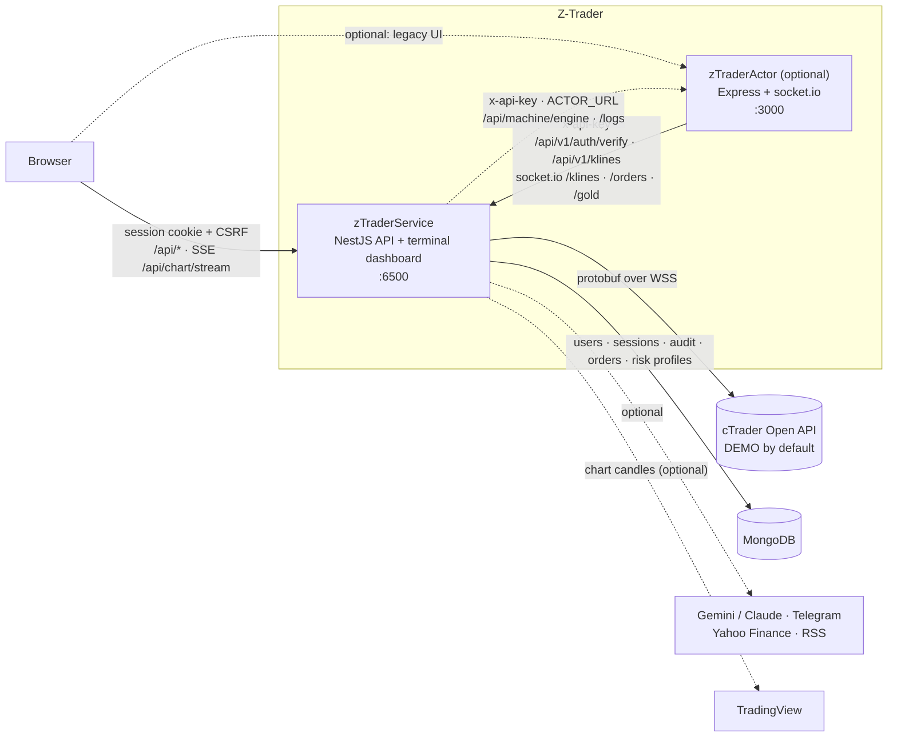

# Z-Trader

Z-Trader is an automated trading platform for gold (XAUUSD) and major FX pairs (EURUSD, GBPUSD, USDJPY) on
the cTrader Open API. This repository holds two services side by side:

| Folder | Role |
|---|---|
| [`zTraderService/`](zTraderService/README.md) | **The core.** A NestJS 12 + TypeScript (strict) trading service. It runs a rule-based TA engine with an optional AI layer (TA only / TA → AI confirm / TA + AI lead / AI only; Gemini or Claude) under code-enforced risk rails, a multi-instrument scheduler, risk limits and risk profiles, an archive of every analysis round with the configuration it ran under, and an audit log. It serves a React 19 trading-terminal dashboard (MUI + TanStack, live charts from cTrader or TradingView) with multi-user auth (viewer / operator / admin) and owns the only connection to the broker and to MongoDB. |
| [`zTraderActor/`](zTraderActor/README.md) | **Optional, legacy.** An Express + socket.io app that runs the older Sonic/Scalper strategy loop and a small operator UI. It has no users or broker credentials of its own. It authenticates its users through zTraderService (`POST /api/v1/auth/verify`), reads market data from the service, and sends orders through the service's machine API. The service dashboard can also start, stop and watch its loop (Strategy page) through API-key machine routes on the Actor. |

> **Trading mode.** Everything trades a cTrader **DEMO** account by default. LIVE needs two explicit
> switches on zTraderService: `CTRADER_ACCOUNT_MODE=LIVE` **and** `CTRADER_ALLOW_LIVE=true`. With only the
> first, the service refuses to boot.

## Architecture



- Browsers use session cookies only. The `x-api-key` is for machine-to-machine calls (Actor → service,
  scripts, and service → Actor for the Strategy page) and is never accepted by the dashboard API.
- There is one user directory. Disabling a user, changing their role or resetting their password on the
  zTraderService dashboard also ends or downgrades their sessions on the Actor, because the Actor re-checks
  `GET /api/v1/auth/users/:id`.

## Run everything with Docker Compose

The compose file lives in `zTraderService/`. It builds the Actor from `../zTraderActor` when the `actor`
profile is enabled.

```sh
cd zTraderService
cp .env.compose.example .env.compose     # fill in the secrets: API_KEY, MongoDB passwords, cTrader credentials
docker compose --env-file .env.compose up -d --build                   # zTraderService + MongoDB
docker compose --env-file .env.compose --profile actor up -d --build   # ... plus zTraderActor
```

`.env.compose` is separate from `.env`, which is the non-Docker development config. For the first admin,
set `BOOTSTRAP_ADMIN_USERNAME` / `BOOTSTRAP_ADMIN_PASSWORD` in `.env.compose` for the first start and then
remove them. With the `actor` profile the service reaches the Actor at `ACTOR_URL` (compose sets
`http://actor:3000`). The dashboard is published on `127.0.0.1:6500` by default. Volumes, the reverse proxy, Coolify
and the full variable list are covered in [zTraderService/docs/deploy.md](zTraderService/docs/deploy.md).

To run without Docker (Node.js 26 LTS, 26.12.1 or later), follow the local-development steps in each sub-README.

## Documentation

- [zTraderService/README.md](zTraderService/README.md): architecture, security model, tests, configuration,
  known limitations
- [zTraderService/docs/api.md](zTraderService/docs/api.md): HTTP and socket.io contract (browser and machine
  APIs, roles, error shape)
- [zTraderService/docs/deploy.md](zTraderService/docs/deploy.md): Docker, compose, Coolify, volumes
- [zTraderService/docs/round-records.md](zTraderService/docs/round-records.md): what every round and order records
  about its configuration (risk profile, risk limits, AI settings, guards, sizing) for backtests
- [zTraderService/docs/ui.md](zTraderService/docs/ui.md): the terminal dashboard — what was borrowed (OpenTerminalUI
  layout, libraries) and what was built for Z Trader
- [zTraderActor/README.md](zTraderActor/README.md): the legacy strategy runner, its auth model and its known issues

## Operational notes

- Run **one** zTraderService instance. The trading loop and the broker socket are in-process.
- The Actor keeps its sessions in memory. A restart logs everyone out of it.
- Do not run the Actor's legacy loop on XAUUSD while the service's gold loop is trading the same account.
