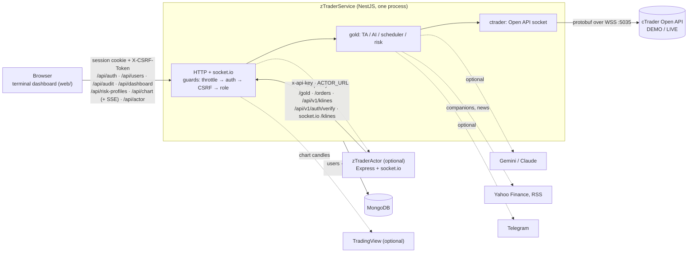

# zTraderService

An automated trading service for gold (XAUUSD) and major FX pairs (EURUSD, GBPUSD, USDJPY) on the
[cTrader Open API](https://help.ctrader.com/open-api/). It ships with a multi-user web dashboard. The
service trades a **DEMO** account by default. LIVE needs two explicit switches (see [LIVE interlock](#live-interlock)).

- **TA engine.** A rule-based engine computes each decision in code. It runs per mode (scalp, intraday,
  swing, position) on cTrader trendbars, plus companion series from Yahoo Finance (DXY, US10Y, VIX, …) and RSS
  headlines. Each mode has its own playbook, minimum R:R, session windows and order TTL.
- **Optional AI, under rails.** The decision mode is chosen on the dashboard: *TA only*, *TA → AI confirm*
  (Gemini confirms, adjusts or vetoes a TA setup), *TA + AI lead* (Gemini also proposes a setup when TA finds
  none, at half size or less, through stricter checks) or *AI only* (the AI proposes every trade; Gemini, or
  Claude with `ANTHROPIC_API_KEY`). The model, the "intelligence" (thinking depth) and a strictness level are
  set on the dashboard too. Strictness only tightens: above *normal*, AI confidence below 6/7/8 vetoes the trade.
  AI output only reaches the broker after code-side guards have passed. The guards cover side of the market,
  entry drift, SL/TP placement, R:R, minimum confidence and size. If Gemini has no key, fails, times out or hits
  its daily call budget, a confirm/lead round uses TA only and an AI-only round places no trade. A Claude
  refusal or a truncated answer is treated as NO_TRADE.
- **Multi-instrument loop.** One scheduler per instrument and mode, aligned to bar closes. It is aware of
  market hours (gold and FX sessions, the daily maintenance break, weekends) and pauses and resumes on its own.
- **Risk limits.** Risk-based sizing (fixed USD per trade, converted per instrument's pip value), per-instrument
  lot caps, open-position caps per instrument and in total, a daily loss stop, a cooldown after a loss, a
  scalp-per-day cap, and a breakeven/trailing manager. Settings changed from the dashboard are persisted so
  that a restart can never silently fall back to looser `.env` values. **Risk profiles** (built-in
  Conservative / Balanced / Aggressive / Micro account, plus saved ones; amounts in USD or % of the balance)
  apply a whole set at once through the same validated path, and are audited.
- **Broker rate limits.** Historical requests (deal lists, trendbars) share one limiter under cTrader's
  per-second cap and retry "rate limited" answers with backoff. The daily-stop and loss-cooldown guards read
  one cached deal list. When it cannot be read, both guards skip the round.
- **Archive and audit.** Every analysis round is written as JSON under `archive/<mode>/`, together with the
  full configuration it ran under (risk profile, limits, AI settings, guards, sizing, `config_hash`). Orders
  carry the same record, so trades can be grouped and replayed for backtests
  ([docs/round-records.md](docs/round-records.md)). This archive feeds the replay regression suite. Every
  dashboard action and every auth event is written to an audit log in MongoDB.
- **Terminal dashboard.** Launchpad workspaces, a live chart with a selectable source (the cTrader account
  broker or TradingView exchanges), bot operations, risk profiles, AI settings and the zTraderActor strategy
  loop in one UI. [docs/ui.md](docs/ui.md) lists what was borrowed (OpenTerminalUI layout, libraries) and what
  was built here.
- **Manual review flow.** `POST /gold/claude/analyze` (or *Analyze* on the dashboard) parks the TA order. A
  human, or an external review script using the machine API, then fires or rejects it within 10 minutes.

## Architecture



The built dashboard (`web/dist`) is served by the same Nest process. The browser therefore talks to a single
origin, and the cookie and `Origin` checks work without CORS.

## Folder layout

```
src/
  main.ts, app.setup.ts   bootstrap; configureApp() is shared with the e2e tests
  app.module.ts           module graph and the global guard chain
  config/                 env validation (fails closed at boot)
  common/                 auth decorators and roles, helmet/CSP, SPA serving, constant-time compare
  auth/                   login, sessions (MongoDB), CSRF and role guards, scrypt hashing, /api/v1/auth for the Actor
  users/  audit/          user management and the audit log (admin)
  health/                 /health (liveness) and /health/ready (MongoDB ping)
  dashboard/              /api/dashboard/*, the browser-facing facade over the gold bot
  account/                account balance for the status bar and % risk profiles
  risk-profiles/          /api/risk-profiles: built-in and saved profiles, apply through the settings path
  chart/                  /api/chart: candles (REST) and live bars (SSE) from cTrader or TradingView
  integrations/tradingview/  TradingView websocket client (framing, throttle, optional sign-in)
  actor-bridge/           /api/actor: proxies the dashboard to zTraderActor's machine routes
  gold/                   the trading bot
    domain/               instrument profiles, mode playbooks, indicators, market hours
    data/                 dataset builder (cTrader + Yahoo + RSS), optional remote ZIP source
    analysis/             rule-based TA engine
    ai/                   Gemini assist/lead/proposals, Claude engine, strictness levels
    records/              archive, activity feed, trade history, shared deal cache, round context (backtest record)
    gold-automate.service.ts   scheduler, risk guards, sizing, order placement, position manager
  ctrader/                cTrader Open API client (protobuf over WebSocket, heartbeat, reconnect, history rate limiter)
  orders/  execution/     POST /orders (idempotent by uuid), order history, placement on cTrader
  klines/                 live trendbar and indicator feed for zTraderActor (REST + socket.io), legacy strategy engine
  telegram/               notifications
  cli/                    create-user command
web/                      React 19 + Vite terminal dashboard (MUI, TanStack Router / Query / Table / Form / Virtual, Vitest)
test/e2e/                 HTTP end-to-end suites (TypeScript, node:test)
test/*.test.js            trading-logic suites against the compiled dist/
proto/                    cTrader Open API .proto files
scripts/                  baseline builder for the regression suite, backtest export/run
docs/                     api.md (HTTP contract), deploy.md (deployment), ui.md (UI origins), round-records.md (backtest records)
```

## Security model

| Concern | Implementation |
|---|---|
| Browser auth | Sessions are stored in MongoDB. The cookie holds a random 256-bit token, and only its SHA-256 is stored. The cookie is `HttpOnly`, `SameSite=Strict`, and over HTTPS it is `__Host-` + `Secure`. A session ends 12 h after login or after 2 h idle. Logout, a password change or reset, a disable and a role change all revoke sessions server-side. |
| Passwords | scrypt (N=2^15, r=8, p=3) with a per-user salt. The parameters are stored in the hash, and old hashes are rehashed on the next login. Passwords are 9–128 characters and may not contain the username. A temporary password forces a change before anything else works. |
| Roles | `viewer` (read), `operator` (trading actions, settings), `admin` (users, audit). The last active admin cannot be demoted or disabled. |
| CSRF | A per-session synchroniser token is required in `X-CSRF-Token` on every write. Writes are also rejected when `Origin` does not match the host. |
| Brute force | Login is throttled per IP (`LOGIN_RATE_LIMIT_PER_MIN`). An account locks for 15 min after 5 failures. Unknown users get the same timing and the same `401`. A global per-IP budget covers every route. |
| Machine API | `x-api-key` (at least 32 characters, compared in constant time). It is accepted **only** on machine routes. A browser session cannot call them, and the key cannot call the dashboard API. The socket.io `/klines` handshake requires the key. The service uses the same key outbound to zTraderActor's `/api/machine/*` routes (Strategy page), always on behalf of a signed-in operator and audited. |
| HTTP hardening | helmet with a strict CSP (`'self'` only plus a per-request nonce for the UI's `<style>` tags, `frame-ancestors 'none'`, no inline script), HSTS, `no-referrer`, `Cache-Control: no-store` on API responses, a 100 kB JSON limit, and whitelist validation that rejects unknown body fields. `TRUST_PROXY` controls which `X-Forwarded-*` headers are believed. |
| Env validation | Boot fails with a list of problems when `MONGO_URI` or `API_KEY` is missing or weak, or when a value is out of range. Tests run with `NODE_ENV=test`, which ignores `.env`. |

### LIVE interlock

`CTRADER_ACCOUNT_MODE=LIVE` alone refuses to boot. Real money also requires `CTRADER_ALLOW_LIVE=true`.
The mode selects the cTrader endpoint (`demo.` or `live.ctraderapi.com`) and the account (`DEMO_ACCOUNT_ID`
or `LIVE_ACCOUNT_ID`). `POST /orders` refuses any `accountId` other than the one the service trades on.

The full HTTP contract is in [docs/api.md](docs/api.md).

## Tech stack

| Layer | Technology |
|---|---|
| Runtime | Node.js ≥ 24.11, TypeScript ~6.0 (strict) |
| API | NestJS 12.3 (Express), @nestjs/throttler 6.7, @nestjs/event-emitter, class-validator 0.15 |
| Realtime | socket.io 4.8 (`@nestjs/platform-socket.io`) |
| Broker | cTrader Open API over `ws` 8.22 + protobufjs 8.8 |
| Database | MongoDB via Mongoose 9.11 |
| Security | helmet 8.3, cookie-parser, Node `crypto` (scrypt, timingSafeEqual) |
| Market data / TA | yahoo-finance2 4.0, rss-parser 3.13, technicalindicators 3.1 |
| AI (optional) | @google/genai 2.31 (Gemini), @anthropic-ai/sdk 1.3 (Claude) |
| Dashboard | React 19.3, Vite 8.3, MUI 9.5 + MUI X Charts 9.16, TanStack Router 1.170 / Query 5.105 / Table 9.3 / Form 1.33 / Virtual 3.14, Lightweight Charts 5.2, react-grid-layout 2.3 — origins in [docs/ui.md](docs/ui.md) |
| Tests | node:test + supertest 7.3 + mongodb-memory-server 11.3 (API), Vitest 5.0 + Testing Library (web) |
| Tooling | ESLint 10 + typescript-eslint 8.72, Prettier 3.9 |

## Local development

Prerequisites: Node.js 24.11 or later, and a MongoDB instance. You can use a local `mongod` or a throwaway
container (`docker run -d --name ztrader-mongo -p 27017:27017 mongo:8`). To run the whole stack in containers
instead (`docker compose --env-file .env.compose up -d --build`), see [docs/deploy.md](docs/deploy.md).

```sh
cd zTraderService
npm ci
npm --prefix web ci
cp .env.example .env      # set MONGO_URI, API_KEY (openssl rand -hex 32), cTrader credentials

npm run build             # API (dist/) + dashboard (web/dist/)
```

Create the first admin in one of two ways:

```sh
# a) CLI: prompts for the password without echo (or reads it from stdin)
npm run user:create -- --username admin --role admin --name "Admin"

# b) bootstrap env: set BOOTSTRAP_ADMIN_USERNAME / BOOTSTRAP_ADMIN_PASSWORD for the first boot only.
#    The admin is created when the users collection is empty. Remove both afterwards.
```

Both ways force a password change at the first login. Then run the service:

```sh
npm start                 # http://localhost:6500  (API + built dashboard)
npm run start:dev         # API with watch mode
npm run dev:web           # Vite dev server for web/, proxies /api and /health to :6500
```

The bot does not trade until you start the loop from the dashboard or set `GOLD_AUTOMATE_ENABLED=true`.
Over plain HTTP the session cookie is named `zt_session` without `Secure`. Behind HTTPS it becomes
`__Host-zt_session`.

## Testing

```sh
npm test                  # build:api, then test:e2e + test:instruments + test:web
npm run test:e2e          # HTTP end-to-end (needs no external services)
npm run test:instruments  # trading-logic suites against dist/ (includes test:tv, test:ratelimit, test:records)
npm run test:regression   # replay against a baseline build (see below); test:all = npm test + this
npm --prefix web test     # dashboard (Vitest)
npm run typecheck && npm run lint
```

| Suite | What it proves |
|---|---|
| `test/e2e/auth.e2e.test.mts` | Login and cookie flags, identical `401` for unknown users, body whitelisting, security headers, CSRF token and `Origin` checks, the role matrix, the forced password change, revocation on disable/reset, the last-admin rule, session listing and revocation, and the 2 h idle / 12 h absolute expiry (with an injected clock). |
| `test/e2e/bruteforce.e2e.test.mts` | Lockout after 5 failures even with the right password (and that it is audited), and the per-IP login throttle. |
| `test/e2e/machine.e2e.test.mts` | API-key routes refuse a bad or missing key. Session and key cannot stand in for each other. Actor endpoints `/api/v1/auth/verify` and `/users/:id`. Strict `POST /orders` validation, the account-id check, idempotency per `uuid` under concurrent requests. The socket.io `/klines` handshake. |
| `test/e2e/proxy.e2e.test.mts` | With `TRUST_PROXY=1` and HTTPS at the proxy, the cookie becomes `__Host-` + `Secure`. |
| `test/e2e/dashboard.e2e.test.mts` | Settings are all-or-nothing, error mapping, the archive never reveals a path, a parked decision is executed at most once, and a fired order stores its configuration, guards and sizing. |
| `test/e2e/terminal.e2e.test.mts` | The per-request CSP style nonce in `index.html`, the account summary, risk profiles (built-in, saved, apply, "modified", audit), AI mode/model/strictness validation and the strictness veto, and the configuration archived with every round. |
| `test/e2e/chart.e2e.test.mts` | Chart sources, bars and the SSE stream (shared upstream, statuses), validation, session-only access. |
| `test/e2e/actor-bridge*.e2e.test.mts` | The Actor bridge: viewer reads, operator start/stop with CSRF and audit, Actor down or unconfigured. |
| `test/tv-protocol.test.js` | TradingView frame encoding and message parsing. |
| `test/history-limiter.test.js`, `test/deal-cache.test.js` | Request spacing, backoff, rate-limit detection, the shared single-flight deal cache, and the daily-stop / cooldown guards failing closed. |
| `test/round-context.test.js` | `config_hash` stability and sensitivity, and that credentials never reach a record. |
| `test/security.test.js` | scrypt and its policy, constant-time compare, a spoofed `X-Forwarded-Proto` has no effect, unsafe env refuses to boot, RSS prompt-injection handling, and no secrets or account ids in AI prompts. |
| `test/gold-ai-assist.test.js`, `test/ai-lead.test.js` | AI assist/lead guard rails: malformed or unsafe AI output is discarded, and AI can only shrink risk in assist mode. |
| `test/gemini-shape.test.js` | Offline Gemini request and response shape (no key, no network). |
| `test/instrument-fx.test.js`, `test/multi-instrument.test.js` | FX profiles (pip value, sizing, market hours, session guards, round numbers), per-instrument state isolation, the total position cap. |
| `test/instrument-regression.test.js` | The XAUUSD decisions of the current build are identical to a baseline build. It replays every archived round and hundreds of seeded synthetic series. |

The e2e suites boot the real `AppModule` from `dist/` with the same `configureApp()` as production, against
mongodb-memory-server (or `TEST_MONGO_URI`). cTrader points at a closed local port, and AI and Telegram keys
are blanked, so no test can reach a broker, a chat or a paid API.

The regression suite needs two local inputs. The first is `dist-baseline/`: `npm run baseline` builds it in a
temporary git worktree from the tag `savepoint-2026-10-28-pre-resume-deploy`, or you pass `BASELINE_DIST`.
The second is a populated `archive/`, which is not committed. On a fresh clone that has neither, run
`npm run test:e2e && npm run test:instruments`.

## Configuration

Every key is listed and commented in [.env.example](.env.example). The ones that matter first:

| Key | Default | Purpose |
|---|---|---|
| `MONGO_URI` | (required) | `mongodb://` or `mongodb+srv://` |
| `API_KEY` | (required, ≥ 32 chars) | machine API key, shared with zTraderActor |
| `NODE_ENV` | `development` | `production` / `test` |
| `PORT` | `6500` | HTTP port |
| `TRUST_PROXY` | `0` | proxy hops to trust (`1` behind Coolify/Traefik) |
| `SESSION_COOKIE_SECURE` | `auto` | `auto` follows the request scheme; `true` / `false` force it |
| `LOGIN_RATE_LIMIT_PER_MIN` | `10` | login attempts per IP per minute |
| `WEB_DIST_DIR` | `./web/dist` | built dashboard |
| `BOOTSTRAP_ADMIN_USERNAME` / `_PASSWORD` | unset | first-run admin, set both or neither |
| `APP_ID`, `APP_SECRET`, `ACCESS_TOKEN` | | cTrader Open API application and token |
| `CTRADER_ACCOUNT_MODE` | `DEMO` | `DEMO` / `LIVE` |
| `CTRADER_ALLOW_LIVE` | `false` | second switch for LIVE |
| `DEMO_ACCOUNT_ID` / `LIVE_ACCOUNT_ID` | | cTrader account ids |
| `CTRADER_HOST` | unset | endpoint override only (tests). Unset = derived from the mode |
| `GOLD_AUTOMATE_ENABLED` | `false` | start the loop at boot |
| `GOLD_INSTRUMENTS`, `GOLD_MODES`, `TRADE_INSTRUMENT` | | what to trade |
| `GOLD_RISK_USD_PER_TRADE`, `GOLD_DAILY_MAX_LOSS_USD`, `GOLD_MAX_OPEN_POSITIONS*`, `GOLD_MAX_LOT*` | | risk limits (also editable from the dashboard) |
| `GOLD_ENGINE`, `GOLD_AI_MODE`, `GEMINI_API_KEY`, `ANTHROPIC_API_KEY`, `GOLD_AI_MAX_CALLS_PER_DAY` | `ta`, `off` | AI engine, role and budget |
| `GOLD_ARCHIVE_DIR`, `GOLD_SETTINGS_FILE` | `./archive`, `./data/runtime-settings.json` | on-disk state; mount these in containers |
| `ACTOR_URL` | unset | zTraderActor base URL for the Strategy page (unset = the page shows "not connected") |
| `TV_AUTH_TOKEN` or `TV_USERNAME` / `TV_PASSWORD` | unset | optional TradingView sign-in for chart data (anonymous access is rate-limited harder) |
| `APP_COMMIT` | unset | git commit of the build, recorded with every round and order |
| `TELEGRAM_BOT_TOKEN`, `TELEGRAM_CHAT_ID` | unset | notifications |

## Deployment and API

- Docker image, compose file, Coolify and the reverse proxy: [docs/deploy.md](docs/deploy.md)
- HTTP and socket.io contract, roles, error shape: [docs/api.md](docs/api.md)
- Dashboard UI: borrowed design vs. our own code: [docs/ui.md](docs/ui.md)
- Round and trade records for backtests (configuration snapshot, `config_hash`): [docs/round-records.md](docs/round-records.md)

## Known limitations

- **Single instance.** The loop scheduler, pending approvals, per-day counters, the breakeven manager and the
  cTrader socket are all in-process, so two replicas would double-trade. Run exactly one.
- **Runtime loop state is in memory.** A restart stops the loop (unless `GOLD_AUTOMATE_ENABLED=true`) and drops
  pending approvals. Risk settings changed from the dashboard survive in `GOLD_SETTINGS_FILE`, which is a
  local file, not MongoDB, so mount it as a volume.
- **Broker payloads are untyped at the protobuf boundary.** Decoded cTrader messages are `any`, which accounts
  for about 125 `@typescript-eslint/no-unsafe-argument` lint warnings. There are no lint errors.
- **zTraderActor sessions are separate.** The Actor verifies credentials against this service and polls
  `/api/v1/auth/users/:id` to pick up disables and role changes. Its own sessions live in its memory, though,
  so they are not listed in or revocable from this dashboard.
- Machine-API calls (`x-api-key`) are not attributed to a user in the audit log. Only dashboard actions are.
- **TradingView chart data uses an unofficial websocket protocol.** It can change without notice and is
  rate-limited, harder without sign-in. It only feeds the chart; the bot always analyses the cTrader feed.
- **The account balance comes from Spotware's account API.** The Open API `ProtoOATraderRes` does not decode
  for the connected account, so the socket is only the fallback.
- The `klines` module still contains the legacy event-driven Sonic/Scalper engine used with zTraderActor. Do
  not run it on XAUUSD at the same time as the gold loop.
